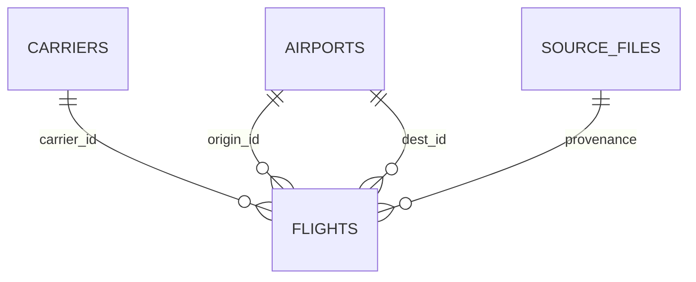

# Từ điển dữ liệu và sơ đồ

| Bảng | Một dòng là gì? |
|---|---|
| carriers | Một mã định danh DOT của hãng báo cáo; reporting_code là nhãn lịch sử nguồn |
| airports | Một AirportID của BTS, code và city của kỳ nguồn |
| source_files | Một snapshot CSV gốc, URL, tên CSV, SHA256 nội dung CSV và SHA256 file đầu vào, thời điểm nhập UTC và số dòng |
| flights | Một bản ghi chuyến đã được báo cáo; không phải một hành khách hoặc một máy bay |
| metadata | Nhãn dữ liệu, tháng, SHA256 và vị trí nguồn cục bộ để đối chiếu lại |

`flight_id` là khóa nội bộ, không phải mã chuyến quốc tế. `source_row` là số thứ tự bản ghi với header=1 (không khẳng định số dòng vật lý nếu ô CSV xuống dòng). Khóa tự nhiên trong snapshot: FlightDate + DOT carrier + Flight_Number + OriginAirportID + DestAirportID + CRSDepTime. Trùng khóa làm dừng nhập, không tự xóa.

`flight_date`: ngày chuyến BTS YYYY-MM-DD, không phải ngày đến thực tế. `flight_number` giữ chuỗi. `origin_id`,`dest_id`: cùng FK airports nhưng vai trò khác; cần hai alias khi JOIN.

`crs_dep_time`,`crs_arr_time`,`dep_time`,`arr_time`: HHMM nguồn địa phương, giữ số0đầu; actual có thể NULL. `scheduled_hour`: nhóm giờ từ CRSDepTime;2400nhóm00. Không dựng timestamp giả từ HHMM hoặc trừ giờ đi/đến qua múi giờ.

`dep_delay`,`arr_delay`: phút có dấu từ nguồn, nguyên; số âm là sớm. Không lấy DepDelay thay ArrDelay. `arr_del15`: cờ nguồn nullable, đối chiếu với ArrDelay>=15 khi chuyến đủ điều kiện. Không tính cờ thiếu thành0.

`cancelled`,`diverted`:0/1, loại trừ nhau trong snapshot này. `cancellation_code`: nhãn nguồn, có thể trống. Không phân tích nguyên nhân trong bản đầu. `distance_miles`: khoảng cách nguồn tính bằng **mile**, không phải kilomet, phải dương.

View `flight_status` không sao chép trạng thái lưu trữ: ưu tiên cancelled → diverted → unknown_arrival → delayed(>=15) → on_time(<15). `eligible`=khônghủy/khôngchuyểnhướng/ArrDelaykhôngNULL.

Các bảng tổng hợp: `total`, `cancelled`, `diverted`, `unknown_arrival`, `eligible`, `delayed`, `delay_sum` (tổng phút ArrDelay có dấu của eligible), `delay_rate_pct`, `cancel_rate_pct`, `mean_arrival_delay_min`. `rank_eligible` chỉ đủ mẫu xếp hạng, không phải xếp hạng chất lượng. `flights_per_day` chỉ có trong day_type_summary, chia số ngày lịch `calendar_days`.

Mọi kết nối bật khóa ngoại; ứng dụng chỉ đọc sau nhập. Schema có UNIQUE, CHECK, indexes. Nhập vào file tạm và công bố no-clobber sau khi kiểm tra. Lỗi không để dữ liệu nửa chừng.
